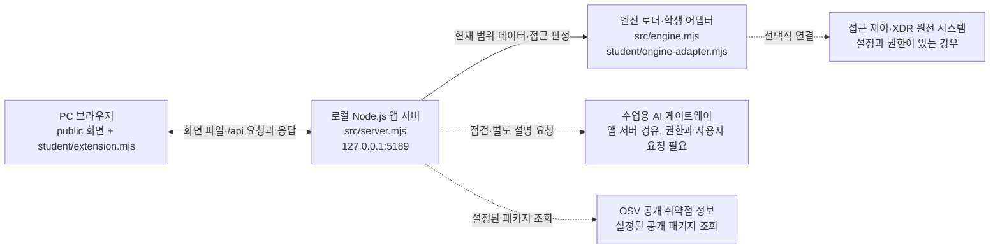

# 케셰브 학생 실행 설명서 및 글 구성도

이 문서는 `on-client` 앱을 Windows PowerShell에서 로컬 실행하는 방법과, 코드상 확인된 범위·아직 실행으로 확인하지 않은 범위를 설명합니다. 명령·구성은 `package.json`, `src/server.mjs`, `src/engine.mjs`, `student/engine-adapter.mjs`, `tools/start-alekov.ps1` 및 기존 학생 문서를 읽어 정리했습니다. 이 작성 과정에서 앱·브라우저·명령을 실행하지 않았습니다.

## 목적과 기능

케셰브는 사용자·기기·세션 정보, 업무 앱 접근 판정, 최근 보안 기록과 XDR 경보, AI 연결·설명, 조치 처리 상태, 전달된 패키지 취약점 조회 결과를 보여 주는 학생용 앱입니다. 실제 값은 서버·엔진이 전달해야 하며, `demo` 자료는 실제 사용자·회사 시스템 결과가 아닙니다.

`student/extension.mjs`의 학생 표시 함수는 다음 범위를 담당합니다.

| 함수 | 학생 영역에서 표시하는 내용 |
|---|---|
| `renderIdentity` | 현재 사용자·기기·세션 및 상태 |
| `renderDecision` | 업무 앱 판정·이유·시각 |
| `renderEvents` | 접속 기록·XDR 경보 목록·필터·상세 |
| `renderStatus` | 기기·세션 상태, 알림, 전달된 진단 정보 |
| `renderAiConnection` | AI 연결 점검 상태와 안전한 오류 안내 |
| `renderExplanation` | 선택한 기록의 참고용 설명·근거·규칙·상태 |
| `renderAction` | 조치 준비·접수·관측 상태 표시. 표시만으로 집행하지 않음 |
| `renderVulnerabilities` | 전달된 취약점 조회 상태·패키지·취약점 |

이 함수들은 화면 표시를 담당합니다. 회사 서버나 AI 게이트웨이의 실제 연결을 보장하지 않습니다. 기기 상태는 악성코드 검사·치료 기능이 아니며, AI 설명은 참고 정보이고 조치를 실행하지 않습니다.

## 필요 환경과 버전

| 항목 | 파일에서 확인한 내용 |
|---|---|
| 운영체제·셸 | 기존 실행 안내와 `tools/start-alekov.ps1`은 Windows PowerShell 기준입니다. |
| Node.js | `package.json`의 `engines.node`는 `24.19.0`입니다. 시작 스크립트는 주 버전 22~24를 허용하고 `v24.19.0`을 권장합니다. 이 두 조건은 파일에 적힌 계약이며 PC의 실제 설치 버전은 확인하지 않았습니다. |
| 앱 버전 | `package.json`의 `0.2.14` |
| npm 의존성·lock | `package.json`에 dependencies/devDependencies가 선언되지 않았고 프로젝트 파일 목록에서 `package-lock.json`은 찾지 못했습니다. 이 설명서는 `npm install`을 요구하지 않습니다. |
| 브라우저 | `http://127.0.0.1`을 열 수 있는 브라우저. 특정 제품·버전은 프로젝트에서 정하지 않았습니다. |

새 PowerShell에서 설치 버전을 직접 확인하려면 다음을 실행합니다. 수업 기준은 `v24.19.0`입니다.

```powershell
node --version
```

실제 PC에서 Node.js가 설치됐는지와 버전은 이 문서 작성자가 확인하지 않았습니다.

## 프로젝트 폴더

명령은 `package.json`이 있는 앱 폴더 `on-client`에서 실행합니다. 예시로 저장소가 `C:\Users\User\Projects\keshev`에 있다면 앱 폴더는 `C:\Users\User\Projects\keshev\on-client`입니다. 예시 경로를 본인 위치로 바꾸세요.

```text
on-client/
├── README.md
├── package.json
├── public/                  제공 화면 파일
├── src/
│   ├── server.mjs           로컬 HTTP 서버와 API 경로
│   ├── engine.mjs           엔진 로딩·연결 안 됨/예제 처리
│   ├── engine/              SDP 연결 구현
│   ├── connection/          계정·연결 처리
│   ├── ai/                  AI 요청 처리
│   ├── actions/             조치 처리
│   └── vulnerabilities/     프로젝트 조회
├── student/
│   ├── extension.mjs        학생 화면 표시 함수
│   └── engine-adapter.mjs   선택적 원천 시스템 어댑터
├── tools/start-alekov.ps1   Windows 실행 전 점검·실행 도구
└── docs/                    학생·구현 안내
```

## 새 PowerShell에서 실행·종료·재실행

### 권장 실행 도구

새 PowerShell을 열고 아래 예시 위치를 실제 앱 폴더로 바꿉니다. 이 도구는 폴더·Node 버전·포트 사용 여부를 확인한 뒤 로컬 서버를 실행합니다. 일반 실행에서는 계정 연결용 로컬 보관소를 준비할 수 있지만, 로그인·승인과 AI 요청은 사용자가 앱 화면에서 직접 합니다.

```powershell
Set-Location 'C:\Users\User\Projects\keshev\on-client'
Test-Path .\package.json
powershell -NoProfile -ExecutionPolicy Bypass -File .\tools\start-alekov.ps1
```

`Test-Path`의 예상 출력은 `True`입니다. 스크립트가 정상으로 판정하면 `케셰브가 켜졌습니다. 브라우저에서 http://127.0.0.1:5189/ 을 여세요.` 및 서버 응답 확인 안내를 출력합니다. 브라우저 주소는 다음과 같습니다.

```text
http://127.0.0.1:5189/
```

이 신호는 로컬 서버가 응답했다는 뜻일 뿐, SDP·회사 서버·AI 연결 성공을 뜻하지 않습니다. 전경 실행을 종료할 때는 PowerShell 창에서 `Ctrl+C`를 누릅니다. 다시 실행하려면 같은 명령을 새로 실행합니다. 실행·종료·재실행은 이 문서 작성 중 실제로 시험하지 않았습니다.

기본 포트가 이미 사용 중이면 다른 프로그램을 종료하지 말고 시작 도구에 다른 포트를 지정합니다. 예:

```powershell
powershell -NoProfile -ExecutionPolicy Bypass -File .\tools\start-alekov.ps1 -Port 5190
```

그때 브라우저 주소도 `http://127.0.0.1:5190/`이어야 합니다. 시작 스크립트는 1024~65535 포트를 허용합니다.

### package.json의 직접 실행 명령

같은 `on-client` 폴더에서 아래 명령도 package script에 실제로 정의되어 있습니다.

```powershell
npm start
```

`npm start`는 `node src/server.mjs`를 바로 실행하고 기본 포트는 `5189`입니다. 권장 시작 스크립트의 사전 점검과 계정 연결용 로컬 준비 과정을 거치지 않는 직접 실행이므로, 특별한 이유가 없으면 위의 `start-alekov.ps1`을 우선 사용하세요. 직접 실행 때 서버 시작 로그는 `케셰브 연결 확인: http://127.0.0.1:5189` 형태입니다. 이 로그도 원천 시스템 연결을 뜻하지 않습니다.

예제 자료로 시작하려면 다음 명령을 사용합니다.

```powershell
npm run demo
```

이는 `--demo`로 서버를 실행하며, 화면·로그의 예제 표시는 실제 사용자 결과나 연결 성공이 아닙니다.

학생 파일의 JavaScript 문법만 검사하는 명령은 다음과 같습니다.

```powershell
npm run check
```

이는 `node --check student/extension.mjs`를 실행합니다. 화면 동작, 실제 API 연결, 판정 또는 제출을 검사하지 않습니다. 문법 검사도 이 문서 작성 과정에서는 실행하지 않았습니다.

포트를 환경 변수로 지정해 직접 실행할 수도 있습니다. 예를 들어 같은 PowerShell 창에서 다음과 같이 실행하고 브라우저도 포트 `5190`으로 엽니다.

```powershell
$env:ON_PORT = '5190'
npm start
```

실행 후 `Ctrl+C`로 끝내고 현재 창의 값을 제거하려면 `Remove-Item Env:ON_PORT`를 실행합니다. 기본·대체 포트 명령을 실제 실행하지는 않았습니다.

## 글로 쓴 시스템 구성도



브라우저는 로컬 서버에서 화면 파일을 받고 `/api/me`, `/api/apps`, `/api/access`, `/api/events`, `/api/devices`, `/api/sessions` 등의 API를 사용합니다. `src/server.mjs`가 API 요청을 처리하고 엔진을 통해 결과를 확인합니다. `student/engine-adapter.mjs`의 기본 export는 `disconnected`이며, 서버 실행자가 설정한 SDP 연결이 있을 때만 연결 어댑터를 구성합니다. 앱은 `127.0.0.1`에 바인딩됩니다.

AI 연결 점검과 선택 사건의 AI 설명은 별개입니다. 점검 응답만으로 사건 설명이 실행됐다고 볼 수 없습니다. 취약점 조회의 범위는 서버의 프로젝트와 허용 공개 패키지 설정에 따릅니다. 미설정·미조회·실패는 ‘취약점 없음’을 의미하지 않습니다. 배포용 Vercel 함수 설정은 프로젝트 파일 목록에서 확인하지 못했으므로 Vercel 또는 GitHub Pages 전체 동작은 이 문서에서 지원·검증 대상으로 주장하지 않습니다.

## 제공 코드와 학생 코드

| 구분 | 파일 | 역할과 경계 |
|---|---|---|
| 제공 UI | `public/index.html`, `public/app.js`, `public/style.css`, `public/vulnerabilities-view.mjs` | 메뉴·입력·갱신 흐름과 화면 틀을 제공합니다. 학생 과제에서 지정하지 않은 수정은 하지 않습니다. |
| 제공 서버 | `src/server.mjs`, `src/engine.mjs`, `src/engine/`, `src/connection/`, `src/ai/`, `src/actions/`, `src/vulnerabilities/` | 로컬 API와 연결·AI·조치·취약점 관련 서버 처리를 담당합니다. |
| 학생 화면 | `student/extension.mjs` | 전달받은 자료와 상태를 렌더링합니다. 실제 연결·조치 집행을 문서만으로 추가하지 않습니다. |
| 선택 어댑터 | `student/engine-adapter.mjs` | 서버와 원천 시스템 사이의 경계입니다. 실제 연결은 준비된 설정과 응답으로 별도 확인해야 합니다. |
| 실행 도구 | `tools/start-alekov.ps1` | Windows 실행 전 폴더·Node 버전·포트 점검 및 서버 시작을 담당합니다. |

`.env` 값, API 키, 토큰, 비밀번호, 개인키·인증서 원문을 문서·커밋·대화창에 넣지 마세요. 이 설명서는 그런 값을 요구하지 않습니다.

## 오류별 확인 순서

| 화면·상황 | 확인 및 다음 조치 |
|---|---|
| 로컬 페이지가 열리지 않음 | PowerShell 현재 위치가 `on-client`인지, `Test-Path .\package.json`이 `True`인지, 시작 서버가 실행 중인지, 브라우저 포트가 시작 포트와 같은지 확인합니다. PowerShell 오류와 기존 `docs/CONNECTION_TROUBLESHOOT.md`를 확인하세요. 원인을 실행 재현한 것은 아닙니다. |
| Node 버전 오류 | `node --version`을 실행해 실제 버전을 확인하고 `package.json`의 `24.19.0` 및 시작 스크립트의 22~24 허용 범위와 대조합니다. |
| 포트 사용 중 | 다른 프로그램을 종료하지 말고 `start-alekov.ps1 -Port 5190`처럼 다른 포트를 사용한 뒤 브라우저도 같은 포트로 엽니다. |
| `demo` / 예제 자료 | `npm run demo`를 실행했는지 확인합니다. 이 결과를 실제 회사 연결로 취급하지 않습니다. |
| `연결 없음` 또는 `기존 서버·에이전트의 연결을 확인할 수 없습니다` | 이번 과정에서는 회사 SDP용 개인 인증서·개인키·접속 토큰을 학생에게 발급하지 않습니다. 이 앱 상태는 과정상 정상입니다. 그대로 과제를 진행하고 인증서·설정 파일을 요청하지 마세요. 이 연결은 13~22단계 판정이나 마무리 제출과 별개입니다. |
| 17단계 뒤 AI 연결 점검 실패 | 먼저 17단계를 실제 통과했는지와 화면 오류 문구를 확인합니다. `ALEKOV_VAULT_`로 시작하는 코드가 있으면 해당 코드 안내를 따릅니다. 다른 경우에는 화면 문구에서 키·토큰·비밀번호·개인정보를 가린 뒤 문구·시각·반 이름을 과제 운영 SKT 담당자에게 보냅니다. 17단계 판정은 실제 AI 연결 성공 여부를 검사하지 않습니다. 권한 준비가 원인이면 학생 잘못이 아닙니다. |
| 그 밖의 ALEPH 도구 오류 | 화면 문구에서 키·토큰·비밀번호·개인정보를 가린 뒤, 그 문구와 시각, 반 이름을 과제 운영 SKT 담당자에게 보내 주세요. 값 자체를 대화창에 붙여 넣지 마세요. |
| 자료 없음·조회 실패·확인 불가 | 화면의 상태 문구와 안전한 서버 메시지를 보고 빈 결과·미조회·오류를 구분합니다. 기존 `docs/CONNECTION_TROUBLESHOOT.md`와 해당 단계 안내를 따르며, 문서만으로 원인을 추측하지 않습니다. |

실제 오류 화면이나 복구 동작은 이 문서 작성자가 확인하지 않았습니다.

## 21·22단계 원문 제출 안내

현재 워크벤치의 ‘포털 제출 준비’는 13~20단계를 지원합니다. 21·22단계는 과제 화면에 저장소 주소와 실제 40자리 커밋을 직접 입력합니다. 비공개 저장소를 공개로 바꾸지 마세요.

1. 학생 문서와 이번 단계 코드를 같은 커밋에 저장합니다. 먼저 Git 상태와 이미 준비된 변경을 확인하고 기존 작업을 보존합니다. 방어전 상황실 4차 탭의 PowerShell 커밋 안내는 13~22단계를 받습니다.
2. 비공개 저장소라면 과제 화면의 **‘비공개 저장소 원문 준비 방법’**에서 **‘원문 전달 도구 받기’**를 사용합니다. ZIP은 프로젝트 밖에 압축 해제하고 JSON용 새 폴더도 프로젝트 밖에 만듭니다.
3. 제출할 프로젝트의 Git 최상위 폴더에서 PowerShell을 엽니다. 과제 화면이 제공한 `student-source-cli.mjs` 명령을 사용하고 도구·출력 경로를 실제 PC에 맞추며 `--commit`에는 실제 제출 40자리 커밋을 지정합니다. 이 문서는 사용자 PC 경로나 커밋을 확인하지 않았으므로 명령을 만들어 내지 않습니다. 과제 화면의 정확한 명령을 따르세요.
4. 도구는 지정 커밋의 원문만 묶으며 학생 코드를 실행하거나 업로드하지 않습니다. 생성 JSON을 같은 단계의 **‘비공개 저장소 원문 묶음’**에서 선택하고 저장소·커밋·단계를 재확인한 뒤 제출합니다.
5. 원문 전달 완료는 AI 검토 통과와 다릅니다. 서버 상태와 판정 설명을 확인합니다. 원문 전달만 실패한 경우 기존 접수를 유지하고 **‘원문만 다시 보내기’**를 사용합니다.

이 문서 작성자는 실제 Git 상태·저장소 주소·커밋·과제 화면의 도구 명령을 확인하지 않았습니다. 이 값을 추측하지 마세요. 비공개 저장소를 공개로 바꾸거나 강제 push·reset·삭제를 하지 마세요.

## 미확인 사항

이 문서는 코드와 기존 문서를 읽어 정리했습니다. 아래 항목은 실제 시험하지 않았습니다.

- PC의 Node.js/npm 설치 버전 및 새 PowerShell에서의 실행·종료·재실행
- 브라우저에서의 메뉴·Tab/Enter 이동, 화면 표시와 새로고침
- SDP/XDR 원천 서버, AI 게이트웨이, 보안 조치 집행 연결
- OSV 실제 조회, API 응답 및 배포된 Vercel/GitHub Pages 화면
- `npm run check` 결과, 모의 데이터 동작, ALEPH 단계 판정
- 로컬 Git 최상위 경로·작업 트리·40자리 커밋·원문 전달 도구의 정확한 명령

OSV 조회 결과가 없다는 것만으로 패키지나 앱 전체가 안전하다고 보장할 수 없습니다. AI 설명·접근 허용 판정·조치 접수 응답도 실제 보안 조치의 효과를 보장하지 않습니다.

## 관련 안내

- [기존 학생 실행 안내](STUDENT_LAUNCH_GUIDE.md)
- [오류 및 연결 문제 해결 안내](CONNECTION_TROUBLESHOOT.md)
- [구현 계약](IMPLEMENTATION_CONTRACT.md)

기존 프로젝트 파일을 삭제하거나 덮어쓰지 말고, 실제 화면 확인은 새 PowerShell에서 본인 프로젝트 경로와 명령을 대조하며 진행하세요.
